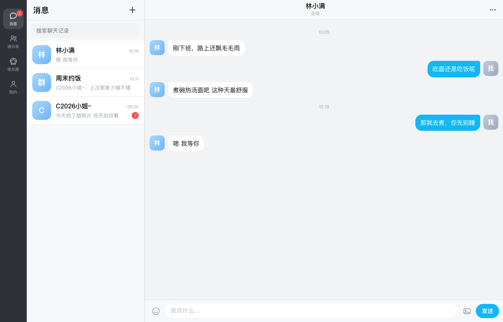
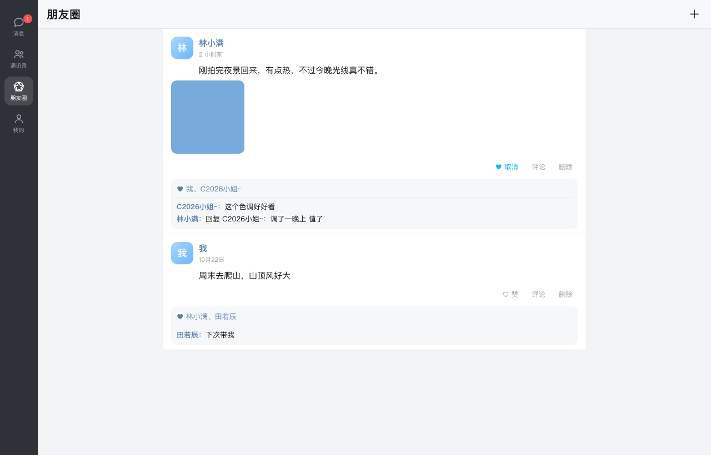
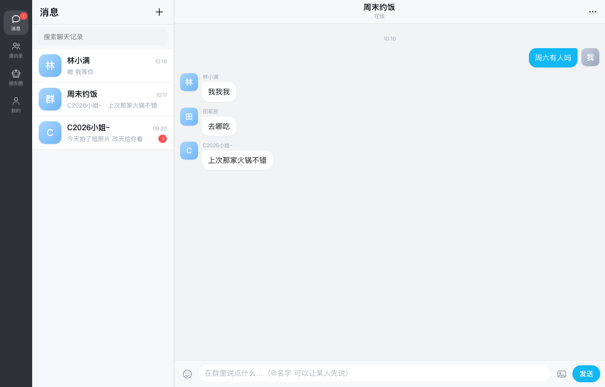

# 轻聊 · Qingliao

**English** | [中文](README.md)

A self-hosted AI chat app: a QQ / WeChat–style interface, with an AI friend on the other side who has a persona, a personality, and a life of her own.

It's not a "prompt box". It's *her*.

## Why I built this

A few days ago I started looking into QQ bots. Chatting with 大肥鱼 was genuinely fun.

As a student I don't have much time to tinker, so I went with the simplest stack: AstrBot + NapCat. But Tencent's risk control is brutal — the account was banned within seconds, every single time. For a student that's terrifying. I just wanted to put my own OC in there and simulate talking to a real person.

So why not take a detour? For someone like me — a bit socially anxious, who doesn't run group chats and doesn't want to talk to strangers in one — I just wanted a realistic interface to chat with an AI. Chatbox and SillyTavern are great, but they don't look like WeChat, QQ, or WhatsApp.

So, after 73 rounds, 746 steps and 250M tokens, I present:

**轻聊 Qingliao**

A semi-automatic, QQ-like thing that imitates a real social app.

It is not a QQ client and does not touch Tencent's services. I built it to host my OCs and run character conversations — to satisfy the feeling that my own little inner world is actually *alive*. "Automatic" means: with a 24/7 server (or something close to it), the agents you create will greet you every morning and night, post to Moments, and talk to each other — all the time. That's pretty cool.

Features and usage below.



## What it is

- **Friends with personas** — name, avatar, personality and way of speaking are all yours to write; she talks that way
- **Moments** — she posts, likes and comments on her own; you can post too, and she'll interact
- **Group chats** — several personas in one group, picking up on each other; `@` someone and they speak first
- **She reaches out** — if you go quiet for a while she sends another message; plus a morning and a night greeting every day
- **Long-term memory** — every 30 messages are compressed into a summary, so three months later she still remembers you hate cilantro
- **Multi-device sync** — data lives on the server; phone / Mac / browser log into the same account and sync within 4 seconds

Built on DeepSeek (`deepseek-flash`, 1M context), and compatible with any OpenAI-format API.

## Screenshots

| Messages | Moments | Group chat |
|---|---|---|
|  |  |  |

## Architecture

```
Browser / Android / macOS
        │  HTTP (JSON + SSE)
        ▼
   nginx  ──►  server.py (Python stdlib, no dependencies)
                   ├── static files   web/
                   ├── accounts       data/users.json
                   ├── per-user state data/users/<id>.json
                   └── background loop: moments / interactions / proactive msgs / memory
```

**Zero third-party dependencies** — all you need is `python3`.

## Quick start

```bash
python3 server.py 8777
# open http://127.0.0.1:8777
# first run: register → Me → Settings → paste your API key
```

To use a different data directory:

```bash
QINGLIAO_DATA=/var/lib/qingliao python3 server.py 8777 --host 0.0.0.0
```

## Deploy to a server

```bash
tar xzf qingliao-server.tar.gz -C /opt/qingliao --strip-components=1
sudo bash /opt/qingliao/deploy/install.sh
```

This installs a systemd service that starts on boot. It listens on `127.0.0.1:8777` by default — when putting nginx in front, **turn buffering off**:

```nginx
location / {
    proxy_pass http://127.0.0.1:8777;
    proxy_http_version 1.1;
    proxy_buffering off;      # required for streaming replies
    proxy_read_timeout 300s;
}
```

## Clients

| Platform | Notes |
|---|---|
| Browser | Open the URL. Width ≥900px switches to the desktop layout automatically |
| Android | `android/build.sh` builds the WebView shell — see the notes in that folder |
| macOS | `desktop/mac/main.swift`, Swift + WKWebView |

## Security notes

This is a **single-user, personal** project. Don't expose it to strangers on the public internet:

- No rate limiting, no CAPTCHA; passwords are only PBKDF2-salted
- Your API key is stored in the server-side state file — keep `data/` at mode `700`
- Prefer a private network / Tailscale, or restrict the security group to your own IP
- For a public domain, add HTTPS yourself

## Layout

```
server.py             all server logic
social_server.py      runs only the Moments scheduler, no web server
web/                  front end (vanilla JS, no framework)
android/              Android WebView shell and build script
desktop/              macOS / Windows clients
deploy/               systemd unit and install script
```

## License

MIT
