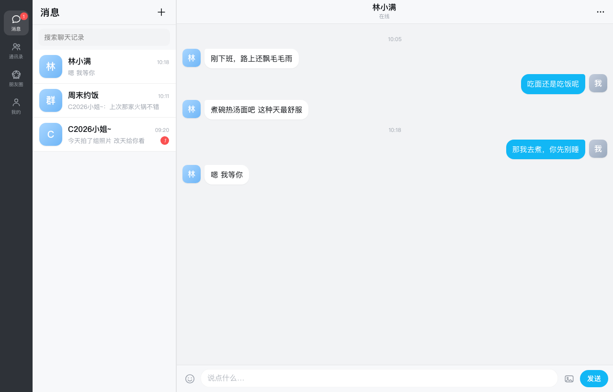
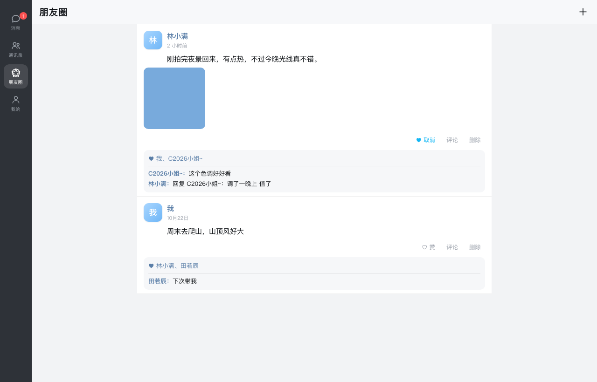
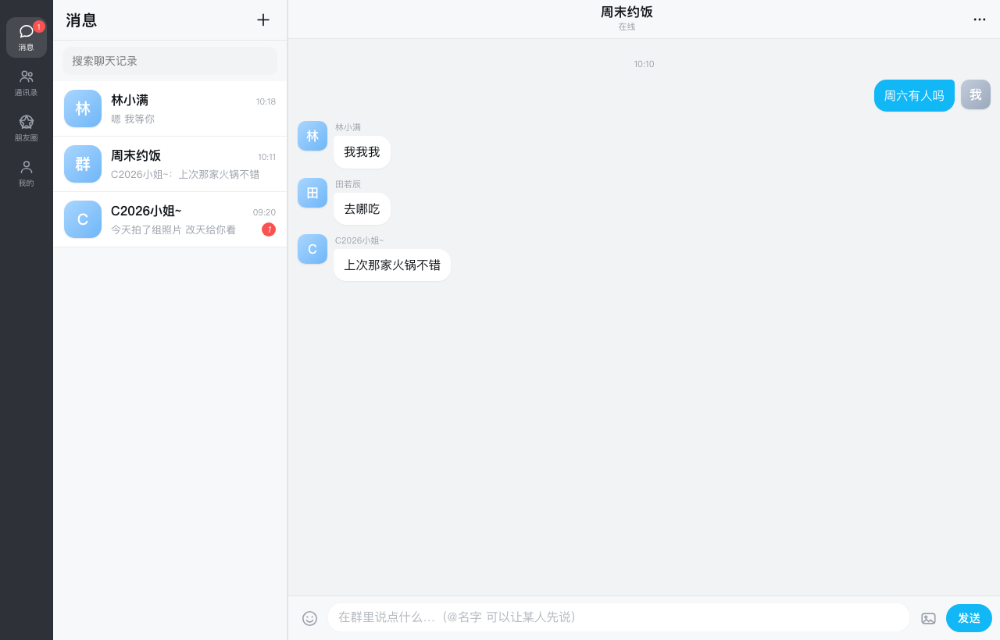

# 轻聊 · Qingliao

[English](README.md) | **中文**

一个自托管的 AI 聊天应用：像 QQ / 微信一样的界面，对面是一个有人设、会主动说话的 AI 朋友。

不是「问答框」，是「她」。

## 自述
大约几天前，我开始尝试研究 QQ Bot 的接入。和 DeepSeek girl 聊天是一件很快乐的事情！

作为学生，我没有太多时间折腾，所以只选用了最简单的 AstrBot + NapCat。但腾讯的风控极其强力，基本上每次都是秒封。对我一个学生来说，这太恐怖了。我只是想把自己的 OC 放上去，模拟和真人聊天啊。

何不曲线救国呢？对我这么一个不拉群、也不想和群友聊天的社恐来说，我只是想用一个比较真实的界面和 AI 聊天，而 Chatbox、SillyTavern 这些现有软件，长得并不像我们的微信、QQ、WhatsApp——

于是，在花了 73 轮、746 步、250M tokens 之后，我隆重推出——

**轻聊 Qingliao**

一个半自动的、模拟真实社交软件的类 QQ 之物。

它不是 QQ 客户端，也不接入腾讯的服务；我做这玩意只是用来放 OC、跑角色对话，单纯满足一下自己内心的小世界其实是“活生生的”的需求。全自动的意思是：如果有一个24小时的服务器，或类服务器，那你创建的智能体就能全天候自动给你早晚安、发朋友圈、互相聊天。这很酷。

具体功能与使用方式见下文。



## 它是什么

- **有人设的朋友**：名字、头像、性格、说话方式都由你写，她按这个跟你聊
- **朋友圈**：她会自己发动态、点赞、评论；你也可以发，她会来互动
- **群聊**：多个人设在一个群里，会互相接话，`@` 谁谁先说
- **主动找你**：你半天没回，她会再发一条；每天早晚各一句问候
- **长期记忆**：每聊 30 条自动压缩成一段摘要；还能手写「她必须记住的事」，随时改、随时删
- **她的日记 / 她自己的生活**：夜里写一页日记（资料页可看）；几小时一条「她生活里的小事」，聊天不再只围着你转
- **纪念日 / 提醒**：认识第 100 天、自定义纪念日她会自己提起；说「明天八点提醒我吃药」她真的会到点提醒
- **会犯错**：偶尔打错字、撤回、重发；很小概率先「已读」你，过一两分钟才回「刚在忙」
- **夜里不打扰**：23:00–08:00 她不会主动冒泡，你发消息照回，你定的提醒照响
- **带得走**：Zip 备份（含图片）一键导出/恢复；角色卡导出/导入；聊天记录可排成一本 .docx 聊天书
- **多端同步**：服务器存数据，手机 / Mac / 浏览器登录同一账号，4 秒内同步；老消息可归档，同步更快

全部基于 DeepSeek（`deepseek-flash`，1M 上下文），也兼容任何 OpenAI 格式的接口。

## 截图

| 消息 | 朋友圈 | 群聊 |
|---|---|---|
|  |  |  |

## 架构

```
浏览器 / Android / macOS
        │  HTTP (JSON + SSE)
        ▼
   nginx  ──►  server.py (Python 标准库，无依赖)
                   ├── 静态页面      web/
                   ├── 账号与会话    data/users.json
                   ├── 每人一份状态  data/users/<id>.json
                   └── 后台调度线程  朋友圈 / 互动 / 主动消息 / 记忆
```

**零第三方依赖**，只要有 `python3` 就能跑。

## 快速开始

```bash
python3 server.py 8777
# 打开 http://127.0.0.1:8777
# 第一次进：注册账号 → 我的 → 设置 → 填 API Key
```

想改数据目录：

```bash
QINGLIAO_DATA=/var/lib/qingliao python3 server.py 8777 --host 0.0.0.0
```

## 部署到服务器

```bash
tar xzf qingliao-server.tar.gz -C /opt/qingliao --strip-components=1
sudo bash /opt/qingliao/deploy/install.sh
```

装完是 systemd 服务，开机自启。默认监听 `127.0.0.1:8777`，用 nginx 反代出去时**务必关掉缓冲**：

```nginx
location / {
    proxy_pass http://127.0.0.1:8777;
    proxy_http_version 1.1;
    proxy_buffering off;      # 流式回复必须
    proxy_read_timeout 300s;
}
```

## 客户端

| 平台 | 说明 |
|---|---|
| 浏览器 | 直接打开地址，宽度 ≥900px 自动切成桌面布局 |
| Android | `android/build.sh` 打包 WebView 壳，见目录内说明 |
| macOS | `desktop/mac/main.swift`，SWift + WKWebView |

## 安全须知

这是一个**单人自用**的项目，别直接开给公网陌生人：

- 服务本身没有限流、没有验证码，登录密码只做了 PBKDF2 加盐
- API Key 保存在服务端状态文件里，请确保 `data/` 目录权限为 `700`
- 建议只在内网 / Tailscale 里访问，或把安全组限制到自己的 IP
- 公网 + 备案域名请自行加上 HTTPS

## 目录

```
server.py             服务端全部逻辑
social_server.py      只跑朋友圈调度、不开网页
web/                  前端（原生 JS，无框架）
android/              Android WebView 壳与打包脚本
desktop/              macOS / Windows 客户端
deploy/               systemd 单元与安装脚本
```

## 更新日志

**2026-10-28 — 1.4.49（网页 v62 / 服务端 v34）**

- 「她会活过来」：撤回/改口/偶尔已读不回（设置里可关）；已读会显示在你最后一条消息下面。
- 她的记忆可看可改（手写「必须记住」优先于自动记忆，可关掉自动更新）。
- 她的日记本、她生活里的小事、纪念日；都按作息和免打扰时段来。
- 「提醒我」：她按 `[[提醒:…]]` 协议记下时间，服务端到点开口（关掉 App 也会响）。
- 备份/恢复升级成带图片的 zip；新增角色卡导入导出、聊天书（.docx）。
- 数据瘦身：可把 N 天前的消息归档到服务器，聊天里「加载更早」翻出来。
- 设置里可调免打扰时段（默认 23:00–08:00），以及每人单独的作息。

**2026-10-23 — 多端同步修复**

- 好友自己的节奏设置（`proactive` / `greet` / `bursts` / `nudgeAfter` / `momentInterval`）改成服务端按字段合并，并下发到每一台设备；另一台设备的旧快照不会再把它们抹掉。
- 客户端改为提交显式编辑（`_edits.friends[id]`），只有真正改过的字段才会写入；清空某项等于取消覆盖，而不是留下旧值。
- 客户端同步循环改成自愈的：每个请求都有超时，卡住的一轮会被看门狗放弃，循环在 `finally` 里重新排队，回到前台立刻补一次。以前只要有一个请求卡死，轮询就会停到重启 App 为止。
- 云端群聊在等服务器生成回复时会显示「她们正在输入…」，刚发的群消息会立刻触发服务端调度，不用等下一个轮询周期。
- `android/build.sh` 不再从打包进 APK 的 `index.html` 里删掉状态栏：页面脚本依赖 `#clock` 元素，删掉后 `init()` 会在「启动同步轮询」之前抛异常 —— 群聊回复就变成只有重启才看得到。

## License

MIT
